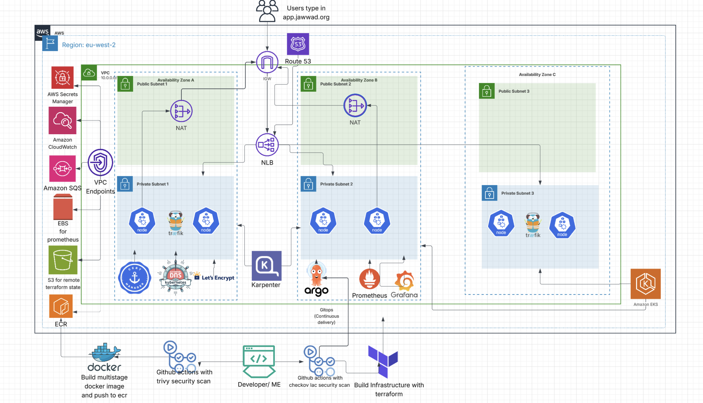
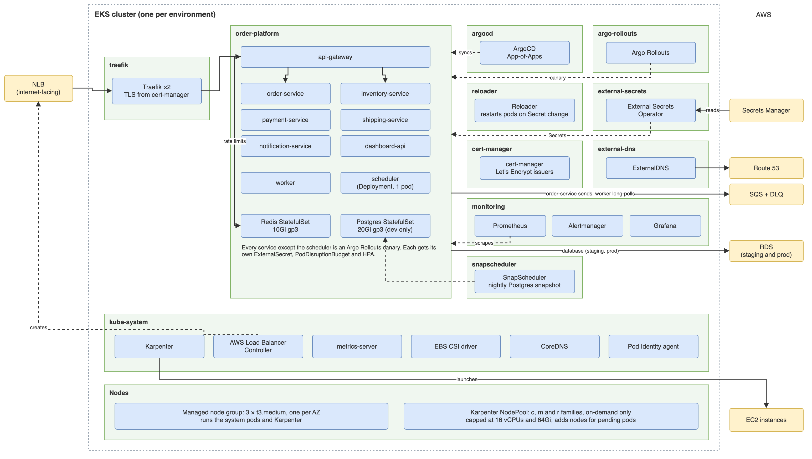

 [README](README.md) ·  [Architecture](#architecture) ·  [Contributing](CONTRIBUTING.md) ·  [Code of conduct](CODE_OF_CONDUCT.md)

# Architecture

This document explains how the order fulfillment platform is built and why. It covers the decisions we made, the options we turned down, and what each choice costs us. The [README](README.md) covers what the platform does and how to run it. The brief we built against is in [REQUIREMENTS.md](REQUIREMENTS.md).

---

## Table of Contents

1. [Goals and Constraints](#goals-and-constraints)
2. [System Overview](#system-overview)
3. [Inside the Cluster](#inside-the-cluster)
4. [Architecture Decisions](#architecture-decisions)
5. [Secrets](#secrets)
6. [Storage](#storage)
7. [Scaling](#scaling)
8. [Database Migrations](#database-migrations)
9. [Deployments and Rollback](#deployments-and-rollback)
10. [Failure Scenarios](#failure-scenarios)
11. [Environments](#environments)
12. [Code Map](#code-map)

---

## Goals and Constraints

The application code was provided. Our job was everything around it: containers, infrastructure, delivery and operations. These goals shaped most of the decisions below, in this order of priority:

1. **No lost orders**: an accepted order must always be processed, even if a downstream service or AWS dependency is briefly down.
2. **No long-lived credentials**: nothing in Git, CI or a container image can be used to access AWS on its own.
3. **Zero-downtime releases**: deploying or rolling back one service never takes the others down.
4. **Everything from Git**: infrastructure through Terraform, workloads through ArgoCD. Nothing is changed by hand in the console or with `kubectl`.
5. **Cost**: this is a dev platform that is torn down when not in use, so we chose the cheaper option wherever it didn't put goals 1 to 4 at risk.

Fixed by the brief: EKS 1.33 or above across three availability zones, Karpenter, Traefik behind an NLB, cert-manager, ExternalDNS, Secrets Manager, GitHub Actions with OIDC, ArgoCD App-of-Apps, and Postgres and Redis running in the cluster on encrypted gp3 volumes.

---

## System Overview

The platform runs in `eu-west-2`, in one AWS account. Dev, staging and prod are kept apart by their own VPC, cluster, Terraform state, GitHub Environment and IAM role (see [Environments](#environments)). Each environment has its own VPC, with three subnet tiers in each of three availability zones:

| Tier     | Contains                        | Internet access                         |
| -------- | ------------------------------- | --------------------------------------- |
| Public   | NLB, NAT gateway                | In and out through the internet gateway |
| Private  | EKS nodes and every pod         | Out only, through the NAT gateway       |
| Database | RDS in production, empty in dev and staging | None. No route to the internet at all   |

Traffic comes in through Route 53, the NLB and Traefik, and reaches the API gateway, which is the only service exposed outside the cluster. Services call each other over HTTP inside the cluster. Order processing runs asynchronously through an SQS queue with a dead-letter queue. The [Request Flow](README.md#request-flow) and [Deployment Process](README.md#deployment-process) sections of the README walk through both paths step by step.

---

## Inside the Cluster

| Namespace          | Runs                                                                             | Installed by                                       |
| ------------------ | -------------------------------------------------------------------------------- | -------------------------------------------------- |
| `order-platform`   | The nine services, Redis, and Postgres in dev and staging                        | ArgoCD ApplicationSet, one Application per service |
| `argocd`           | ArgoCD                                                                           | Terraform (`infra/argocd-bootstrap`)               |
| `traefik`          | Traefik, two replicas on different nodes                                         | ArgoCD                                             |
| `kube-system`      | Karpenter, AWS Load Balancer Controller, metrics-server, EBS CSI driver, CoreDNS | ArgoCD and EKS add-ons                             |
| `external-secrets` | External Secrets Operator                                                        | ArgoCD                                             |
| `cert-manager`     | cert-manager and the Let's Encrypt issuers                                       | ArgoCD                                             |
| `external-dns`     | ExternalDNS                                                                      | ArgoCD                                             |
| `monitoring`       | Prometheus, Grafana                                                              | ArgoCD                                             |
| `reloader`         | Stakater Reloader                                                                | ArgoCD                                             |

ArgoCD installs the platform tools in sync waves before the services, because the services depend on them: Traefik routes their traffic, External Secrets creates their Secrets, and cert-manager issues their certificate.

---

## Architecture Decisions

Each decision lists the context, what we chose and what it costs us.

### 1. Postgres on a StatefulSet in dev and staging, RDS in production

**Context**: Postgres holds the only durable business data. The brief requires it to run in the cluster on a StatefulSet with a 20Gi encrypted gp3 volume, and grades a volume snapshot that has actually been restored. Production needs automated backups, failover and patching that we don't want to run ourselves.

**Decision**: dev and staging run Postgres on a single-replica StatefulSet with a 20Gi encrypted gp3 volume. Production runs on Amazon RDS, from `infra/terraform/modules/rds`. The services can't tell the difference: each one builds its `DATABASE_URL` from the same two secrets, which point at either the StatefulSet or RDS.

**Why a StatefulSet in dev and staging**:

- It meets the brief, and it makes us solve the hard problems ourselves: volumes tied to one AZ, snapshots, restores and what happens when the pod dies.
- It is cheaper for environments that are rebuilt often. The volume costs a few dollars a month, and the database shares nodes we already pay for.
- Postgres is reached the same way as Redis, through a cluster DNS name, so the services need no network path out of the cluster.

**Why RDS for production**:

|                       | StatefulSet                                                      | RDS                                                           |
| --------------------- | ---------------------------------------------------------------- | ------------------------------------------------------------- |
| Backups               | Volume snapshots we schedule and test                            | Automated, with restore to any second in the retention window |
| AZ failure            | Down until the AZ returns or we restore a snapshot in another AZ | Multi-AZ fails over to a standby in about a minute            |
| Patching and upgrades | Our job                                                          | Managed, inside a maintenance window                          |
| Cost (non-prod)       | Volume only                                                      | Instance plus storage, even when idle                         |

The RDS module already enforces production settings: Terraform refuses to apply in `prod` without Multi-AZ, deletion protection, a final snapshot, at least seven days of backups and a non-burstable instance class.

**Trade-off**: in dev and staging, a single Postgres pod is a single point of failure. If its node or AZ goes down, the platform can't write orders until Postgres is back. We accept that outside production. Production runs on RDS with Multi-AZ, so it fails over to a standby in another AZ.

### 2. Helm over Kustomize

**Context**: nine services with almost identical Kubernetes needs: a Deployment, Service, ExternalSecret, PodDisruptionBudget and optionally an HPA, ServiceMonitor and IngressRoute. They differ in a handful of values.

**Decision**: one Helm chart, `kubernetes/charts/microservice`, used by every service. Values are layered from general to specific:

1. `kubernetes/deploy/services/<service>/values.yaml`: what is true for the service in every environment (port, component, resources).
2. `kubernetes/deploy/envs/<env>/common.yaml`: what is true for every service in that environment (image repository, secret names).
3. `kubernetes/deploy/envs/<env>/<service>.yaml`: the image tag and anything specific to that service in that environment.

**Why**:

- A fix to the chart, such as a security context or probe change, reaches all nine services at once.
- The chart enforces rules no overlay can: `values.schema.json` rejects unknown or mistyped values, and the chart fails to render if the scheduler is given more than one replica or an HPA.
- An ArgoCD ApplicationSet creates one Application per folder in `kubernetes/deploy/services/`. Adding a service means adding a folder.
- CI runs `helm lint` and validates every rendered service against the Kubernetes schemas with kubeconform.

**Trade-off**: templates are harder to read than plain YAML, and a mistake in the chart affects every service. Kustomize would be simpler for one-off patches. We chose shared logic over that simplicity, and rely on the schema and the CI render check to catch chart mistakes before they merge.

### 3. EKS Pod Identity instead of IRSA

**Context**: the brief asks for IRSA for every service that touches AWS. Its purpose is that each workload gets its own narrowly scoped IAM role, and never uses the node's role.

**Decision**: we use EKS Pod Identity, the newer mechanism with the same goal. Each workload that calls AWS has its own role and a Pod Identity association, both in Terraform (`infra/terraform/modules/pod-identity`):

| Workload                     | Allowed to                                                            |
| ---------------------------- | --------------------------------------------------------------------- |
| order-service                | `sqs:SendMessage` on the order events queue only                      |
| worker                       | `sqs:ReceiveMessage` and `sqs:DeleteMessage` on the same queue only   |
| External Secrets             | Read the four application secrets and decrypt them with their KMS key |
| ExternalDNS, cert-manager    | Change records in the platform's hosted zone only                     |
| Karpenter                    | Launch and terminate instances tagged for this cluster                |
| AWS Load Balancer Controller | Manage the NLB                                                        |
| EBS CSI driver               | Create, attach and snapshot volumes                                   |

No other service has AWS permissions. The nodes require IMDSv2 with a hop limit of 1, so a pod cannot reach the node's own role.

**Why**:

- No OIDC provider per cluster. With IRSA, each new cluster needs its own OIDC provider and every role's trust policy must name it. Pod Identity roles trust `pods.eks.amazonaws.com`, so the same role definition works for dev, staging and prod.
- The link between a role and a service account lives in Terraform, next to the role, instead of in an annotation in the Helm values.
- AWS now recommends Pod Identity for new EKS clusters.

**Trade-off**: it needs the Pod Identity agent add-on running on every node, and it doesn't work on Fargate. It also departs from the wording of the brief, though it meets the intent: least privilege, one role per workload, no shared credentials.

### 4. Keeping the NAT gateway

**Context**: the brief says to avoid NAT gateways if we can.

**Decision**: we keep one NAT gateway, in the first public subnet. S3 traffic bypasses it through a free gateway endpoint.

**Why it stays**: several parts of the platform need to reach the public internet, which VPC endpoints cannot provide:

- ArgoCD pulls this repository from GitHub.
- cert-manager talks to Let's Encrypt.
- Platform images come from public registries such as quay.io, ghcr.io and Docker Hub.

The services also call AWS APIs: SQS, Secrets Manager, STS, ECR and EKS. Interface endpoints for all of these would cost far more than the NAT gateway (each endpoint is charged per AZ, per hour) and still wouldn't cover GitHub or Let's Encrypt.

**Trade-off**: a single NAT gateway is a single point of failure for outbound traffic. If its AZ goes down, pods in all three AZs lose internet access, so image pulls, certificate renewals and ArgoCD syncs fail until it returns. Traffic already inside the cluster is not affected.

### 5. SQS over Kafka

**Decision**: Amazon SQS with a dead-letter queue, rather than Kafka through Strimzi.

**Why**:

- The services were written for SQS, so no application code had to change.
- SQS is fully managed and costs almost nothing at our volume. Strimzi would mean running at least three brokers on persistent volumes, inside a cluster we already find hard enough to keep stateful.
- Dead-letter queues, retries and visibility timeouts are built in.

**Trade-off**: SQS delivers each message at least once and doesn't guarantee order. Every step the worker takes is therefore safe to repeat: it checks the order's status first, and reserving, charging and confirming twice changes nothing. Once a message is deleted it can't be replayed, unlike a Kafka topic.

To make sure no order is lost between Postgres and SQS, order-service uses a transactional outbox. The order and its event are saved in the same database transaction, and a background loop sends saved events to SQS. If SQS is down, orders are still accepted and the events are sent when it returns.

### 6. External Secrets over the Secrets Store CSI Driver

**Decision**: External Secrets Operator syncs Secrets Manager values into Kubernetes Secrets.

**Why**:

- The services read configuration from environment variables. External Secrets produces an ordinary Secret that the Deployment loads with `envFrom`, so no application code changes.
- It can build values from several secrets. Each service's `DATABASE_URL` is assembled from the credentials secret and the connection secret, so the services never need to know where the database lives.
- It refreshes on a schedule, which is what makes rotation work (see [Secrets](#secrets)).

**Trade-off**: secret values are stored in the cluster as Kubernetes Secrets. We mitigate this with KMS envelope encryption on the EKS secrets store, so they are encrypted at rest in etcd. The CSI driver can avoid creating Secrets, but only if the apps read files, which ours don't.

### 7. GitOps with ArgoCD

**Decision**: CI never deploys to the cluster. It builds, scans and pushes an image, then commits the new image tag to the environment's values file. ArgoCD sees the change in Git and syncs it.

**Why**:

- Git is the single record of what is running. Rolling back a service means reverting one commit.
- CI has no cluster credentials, so a compromised pipeline can't change the cluster directly.
- Self-heal reverts any manual change made in the cluster.
- Every service is its own Application, so one service's deploy or rollback doesn't touch the other eight.

**Trade-off**: deploys take slightly longer, because ArgoCD has to detect the commit first. CI also writes to `main` through a GitHub App, which has to be allowed past branch protection for that one path.

### 8. Karpenter on top of a small managed node group

**Decision**: a managed node group of three on-demand `t3.medium` nodes, one per AZ, runs the system components and Karpenter itself. Karpenter adds and removes nodes for everything else.

**Why**: Karpenter can't run on nodes it manages, so it needs a fixed base. Above that, Karpenter picks the cheapest instance that fits the pending pods, typically within a minute, and consolidates underused nodes. Cluster Autoscaler can only scale node groups of fixed instance types.

**Trade-off**: the three base nodes are always paid for. The Karpenter NodePool is on-demand only, and is capped at 16 vCPUs and 64Gi of memory so that a scaling bug can't run up a large bill.

### 9. Terraform split into three stacks

| Stack                     | Creates                                                       | Run                                                             |
| ------------------------- | ------------------------------------------------------------- | --------------------------------------------------------------- |
| `bootstrap/`              | State bucket, ECR, GitHub OIDC provider and roles, hosted zone | Once per account, locally                                       |
| `infra/terraform/`        | VPC, EKS, IAM, SQS, Secrets Manager, KMS                      | Through the Terraform Plan and Apply pipelines                  |
| `infra/argocd-bootstrap/` | ArgoCD and the root Application                               | Through the ArgoCD Bootstrap pipeline, after the cluster exists |

**Why**: the bootstrap creates what the pipelines need to run, so it can't run through them. ArgoCD is kept separate from the cluster because the Kubernetes and Helm providers need a running cluster to plan against. Each stack has its own state file, so an ArgoCD change can never plan a change to the VPC.

**Trade-off**: building from scratch takes three steps in order instead of one.

---

## Secrets

### From Secrets Manager to a pod

1. **Created by Terraform**: Terraform generates the JWT secret, the Grafana password and the database password, and stores them in Secrets Manager encrypted with a customer-managed KMS key. The values are write-only: they never appear in Terraform state or plan output.
2. **Read by External Secrets**: External Secrets uses its Pod Identity role, the only role allowed to read these secrets, through one `ClusterSecretStore`.
3. **Synced into Kubernetes**: each service has an `ExternalSecret` that lists only the values it needs. It creates a Secret with the same name as the Deployment. Database services get a ready-built `DATABASE_URL`, and api-gateway gets `JWT_SECRET`.
4. **Loaded by the pod**: the Deployment loads the Secret as environment variables. Pods run as non-root, with a read-only root filesystem and no service account token mounted.

No secret is in Git, in an image or in an env file.

### What happens on rotation

1. The new value is written to Secrets Manager. For the database password, Terraform writes it to the secret and to the database in the same apply, by increasing the version number on the secret.
2. External Secrets picks up the change within its 15-minute refresh interval and updates the Kubernetes Secret.
3. Reloader sees the Secret change and restarts only the Deployments that use it, one pod at a time, with the same zero-downtime rolling update as a release.

**Do all nine services restart?** No. Only the services that use the changed secret restart. A JWT rotation restarts api-gateway only. A database password rotation restarts the seven services that use the database. The worker and api-gateway are not affected.

**The gap**: between the password changing in the database and the pods restarting, new database connections from the old pods fail. Existing connections keep working. That window can last up to the refresh interval.

---

## Storage

### How the volumes are backed

In dev and staging, Postgres and Redis each run as a StatefulSet with a volume created from a `volumeClaimTemplate`. In production, Redis runs the same way and Postgres runs on RDS (see [Production database](#production-database)). The AWS EBS CSI driver, installed as an EKS add-on with its own Pod Identity role, creates each volume as an EBS disk.

|             | Postgres                | Redis                  |
| ----------- | ----------------------- | ---------------------- |
| Size        | 20Gi                    | 10Gi                   |
| Type        | gp3                     | gp3                    |
| Persistence | Postgres data directory | AOF (append-only file) |

The `gp3` StorageClass is the cluster default. It encrypts every volume, and uses `WaitForFirstConsumer` so the disk is created in the same AZ as the node the pod is scheduled on.

### Encryption

| Data                          | Encrypted with                                                    |
| ----------------------------- | ----------------------------------------------------------------- |
| EBS volumes (Postgres, Redis) | KMS, through the `gp3` StorageClass                               |
| EBS snapshots                 | Inherit the volume's encryption                                   |
| RDS storage and backups (prod) | Customer-managed KMS key, shared with Secrets Manager            |
| Kubernetes Secrets in etcd    | Customer-managed KMS key, rotated yearly                          |
| Secrets Manager               | Customer-managed KMS key, rotated yearly                          |
| SQS messages                  | SQS-managed encryption                                            |
| Terraform state               | S3 encryption, with a bucket policy that rejects non-TLS requests |
| Traffic from users            | TLS from Let's Encrypt, terminated at Traefik                     |

### Snapshots

The snapshot-controller EKS add-on adds the VolumeSnapshot resources to the cluster, and a `VolumeSnapshotClass` tells the EBS CSI driver to take them. The class uses `deletionPolicy: Retain`, so deleting the Kubernetes object never deletes the EBS snapshot underneath it.

A snapshot is an incremental, point-in-time copy of the EBS volume, stored by AWS across the whole region. It is crash-consistent: it captures the disk as if the power had been cut, which Postgres recovers from on start-up by replaying its write-ahead log.

### Restore procedure

A restore never writes back onto the old disk. It creates a new volume from the snapshot, under the name the StatefulSet expects:

1. Take a snapshot of `data-postgres-0` and wait until it shows `READY true`.
2. Scale the Postgres StatefulSet to 0.
3. Delete the PVC `data-postgres-0`.
4. Create a PVC with the same name, with the snapshot as its `dataSource`.
5. Scale the StatefulSet back to 1. The pod starts on the restored volume.

The restore test proves the data comes back, not just that the commands run:

1. Place known orders through the dashboard.
2. Take a snapshot.
3. Delete the orders from the database.
4. Restore the volume from the snapshot.
5. Check the original orders are back in the dashboard.

### When an AZ goes down

In dev and staging, an EBS volume exists in one AZ only, and Kubernetes pins the PVC to it. A Postgres pod can be moved to another node in the same AZ, but never to another AZ.

- **Pod or node failure**: the StatefulSet recreates the pod, and it reattaches the same volume. No data is lost.
- **AZ failure**: the pod stays `Pending`, because no node in another AZ can attach the volume. Orders can't be written until the AZ comes back.
- **Recovery without waiting**: snapshots are regional, so we can restore the latest snapshot into a new volume in a healthy AZ. Anything written after that snapshot is lost.

This is why production runs on RDS Multi-AZ. The stateless services already survive an AZ failure, because their pods are spread across AZs and nodes.

### Production database

| | RDS in production |
|---|---|
| Storage | gp3, starting at 50 GiB and growing automatically up to 200 GiB |
| Encryption | Customer-managed KMS key, for the storage and every backup |
| Availability | Multi-AZ: a synchronous standby in a second AZ takes over automatically |
| Backups | Automated daily backups kept for 14 days, with restore to any second in that window |
| Deletion | Deletion protection on, and a final snapshot taken if the instance is ever deleted |
| Network | Database subnets with no internet route. Only the EKS cluster's security group can reach port 5432 |

Terraform refuses to apply in `prod` unless Multi-AZ, deletion protection, the final snapshot and at least seven days of backups are all set.

**Restore procedure**: RDS never restores onto the running instance. It creates a new one:

1. Restore the instance to the chosen point in time, as a new instance.
2. Check the data on the new instance.
3. Point the `db-connection` secret at the new instance's address.
4. External Secrets picks up the change and Reloader restarts the services, one pod at a time, onto the restored database.

---

## Scaling

| Component                         | Scales                    | On                     | Limits                                                   |
| --------------------------------- | ------------------------- | ---------------------- | -------------------------------------------------------- |
| api-gateway and the HTTP services | Horizontally, with an HPA | CPU, target 70%        | 2 to 5 pods                                              |
| worker                            | Fixed                     |                        | 1 pod                                                    |
| scheduler                         | Never                     |                        | 1 pod. A second pod would run every job twice            |
| Postgres, Redis                   | Never                     |                        | 1 pod each. Writes can't be spread across plain replicas |
| Traefik                           | Fixed                     |                        | 2 pods on different nodes                                |
| Nodes                             | Karpenter                 | Pending pods           | 16 vCPUs, 64Gi memory                                    |

**Why CPU for the HTTP services**: they are stateless Go services whose load follows requests closely, and CPU needs only metrics-server.

**Why the scheduler is fixed**: its jobs, such as expiring reservations and cancelling abandoned orders, must run once. The chart refuses to render the scheduler with more than one replica or with an HPA, and uses the `Recreate` strategy so an old and a new pod never overlap.

### What breaks first

1. **Postgres connections**. Each service keeps its own connection pool. At one pod per service, the pools already allow 115 connections, more than Postgres's default limit of 100. Every new pod an HPA adds brings up to 25 more. Under load, services start failing with "too many connections" well before the database runs out of CPU.
2. **Postgres itself**. It is one pod on one volume. Reads could move to a replica, but every write goes to the same instance.
3. **Redis**. If Redis is unavailable, api-gateway lets requests through instead of rejecting them, so the platform stays up without rate limiting.
4. **The queue**. If the worker falls behind, SQS holds the backlog for four days. Orders slow down, but none are lost.

---

## Database Migrations

### How it works today

Five of the seven services that use the database own their own tables, and create them on start-up with `CREATE TABLE IF NOT EXISTS`. dashboard-api and the scheduler only read and update tables owned by other services.

This works for creating tables, but it can't change an existing table, it keeps no record of which changes have been applied, and nothing can be rolled back.

### The approach

- **Versioned migration files** with golang-migrate, in one ordered history for the one shared database. golang-migrate takes a database lock, so two migration runs can never overlap.
- **A Kubernetes Job before the deploy**, run as an ArgoCD PreSync hook. If the Job fails, the sync stops and the services are not updated.
- **Expand, then contract**. Every schema change has to work with both the old and the new version of the code, because during a rolling update both versions run at once.

**Example: adding a column to `orders`, which dashboard-api also reads**

1. **Expand**: add the column as nullable or with a default. The old code ignores it.
2. Deploy order-service so it writes the new column.
3. Backfill existing rows if needed.
4. Deploy dashboard-api so it reads the new column.
5. **Contract**: in a later release, once no running code uses the old shape, remove what's no longer needed.

At no point does a running pod see a table it doesn't understand, so there is no downtime.

### Rollback

- **Code**: revert the image tag commit. Because every migration is backward compatible, the previous version still works against the new schema.
- **Schema**: we don't run down migrations in production, because a down migration that drops a column also drops the data in it. A bad migration is fixed with a new migration that moves forward.
- **Data**: before a risky migration, take a volume snapshot. If data is damaged, restore it.

---

## Deployments and Rollback

**Zero-downtime rollouts**: every Deployment uses a rolling update with `maxUnavailable: 0` and `maxSurge: 1`. A new pod only receives traffic once its readiness probe passes, and an old pod waits 10 seconds before shutting down so in-flight requests can finish. PodDisruptionBudgets and topology spread constraints keep pods spread across nodes and AZs during node drains and Karpenter consolidation.

**Failed rollouts**: if a new pod never becomes ready, the rollout stops after 5 minutes and the old pods keep serving traffic. ArgoCD shows the Application as degraded.

**Rollback**: revert the commit that changed the service's image tag. ArgoCD syncs the previous tag for that one service, and the other eight are untouched. Because the image is already in ECR, a rollback takes about as long as one rolling update.

**Pipelines stay separate**: infrastructure changes run through the Terraform pipelines when `infra/` changes. Application changes run through the Application Pipeline when `services/` changes, and only for the services that changed. The two share nothing except the image tag that ArgoCD reads from Git.

---

## Failure Scenarios

**The worker fails to process an event three times.**
The message isn't deleted, so SQS hands it out again after the 60-second visibility timeout. After three attempts, SQS moves it to the dead-letter queue, which keeps messages for 14 days. Once the cause is fixed, the messages are redriven to the main queue. Because every worker step is safe to repeat, a redriven order resumes where it stopped.

**payment-service is down for two minutes.**
New orders are still accepted, because placing an order doesn't call payment-service. The worker's charge calls fail, so the messages go back to the queue and are retried. Most are processed once payment-service returns. A message that fails three times moves to the dead-letter queue. The stock stays reserved for 15 minutes before the scheduler releases it.

**A bad image is pushed for notification-service.**
The new pods fail their readiness probe, so the old pods keep serving and no traffic is lost. Reverting the tag commit rolls back that one service. ArgoCD helps here: each service is its own Application, and Git shows exactly which commit to revert.

**The Postgres pod is deleted.**
The StatefulSet recreates it with the same name and the same volume. Services lose their database connections for a few seconds, then reconnect.

**Spot instances.**
The stateless services and the worker tolerate being evicted, because they run several replicas and retry their work. Postgres, Redis and the scheduler can't, because each runs as a single pod. The NodePool is on-demand only.

**Logging cost.**
The EKS control plane sends all five of its log types to CloudWatch, kept for 30 days.

---

## Environments

The platform runs three environments from the same code:

|                   | dev                                   | staging                                   | prod                                   |
| ----------------- | ------------------------------------- | ----------------------------------------- | -------------------------------------- |
| AWS account       | Shared                                | Shared                                    | Shared                                 |
| VPC CIDR          | `10.6.0.0/16`                         | `10.7.0.0/16`                             | `10.8.0.0/16`                          |
| Hostname          | `dashboard.dev.eksv2.naimaosmann.com` | `dashboard.staging.eksv2.naimaosmann.com` | `dashboard.prod.eksv2.naimaosmann.com` |
| ArgoCD sync       | Automatic                             | Automatic                                 | Manual                                 |
| Terraform         | `envs/dev.tfvars`                     | `envs/staging.tfvars`                     | `envs/prod.tfvars`                     |
| Kubernetes values | `kubernetes/deploy/envs/dev/`         | `kubernetes/deploy/envs/staging/`         | `kubernetes/deploy/envs/prod/`         |

**Why one account**: a separate prod account needs cross-account access for the shared ECR repository, the Route 53 zone, Secrets Manager and the Terraform state, which didn't fit the time we had. Prod is kept apart inside the account instead. Each environment has its own Terraform state, GitHub Environment and IAM role. The prod role only trusts jobs running as the `prod` GitHub Environment, which only deploys from `main`, and every prod apply or destroy waits for an approval from someone other than the person who started it.

**Who can change an environment**: pull requests plan every environment with a read-only role and can't change anything. Apply, Destroy and ArgoCD Bootstrap run as the chosen GitHub Environment, which only deploys from `main`, and get that environment's role. Staging and prod only apply a plan made by a manual Terraform Plan run on `main`. Prod apply and destroy open an issue and wait for one of `PROD_APPROVERS` to comment `approve`; whoever started the run can't approve it. CI pushes images with a role that can only push to the shared ECR repository.

**Promotion**: images are built once. Promoting a release copies the tested image tag from dev's values to staging's, then to prod's, in a pull request.

---

## Code Map

| Path                              | What it is                                                                                                             |
| --------------------------------- | ---------------------------------------------------------------------------------------------------------------------- |
| `services/`                       | The nine Go services, each with its own multi-stage Dockerfile                                                         |
| `bootstrap/`                      | One-off Terraform: state bucket, ECR, GitHub OIDC role, hosted zone                                                    |
| `infra/terraform/`                | The platform's AWS infrastructure, one module per area (`vpc`, `eks`, `pod-identity`, `secrets-manager`, `sqs`, `rds`) |
| `infra/argocd-bootstrap/`         | Installs ArgoCD and the root Application                                                                               |
| `local/kind/`                     | Config for a local kind cluster                                                                                        |
| `kubernetes/charts/microservice/` | The shared Helm chart for every service                                                                                |
| `kubernetes/deploy/`              | Values for each service and each environment                                                                           |
| `kubernetes/platform/`            | The root App-of-Apps, the platform Applications and cluster-wide manifests                                             |
| `kubernetes/helm-values/`         | Values for the third-party charts (Traefik, Karpenter, cert-manager and others)                                        |
| `.github/workflows/`              | CI and infrastructure pipelines                                                                                        |
| `docker-compose.yml`              | Runs all services locally, with Postgres, Redis and a local SQS                                                        |
