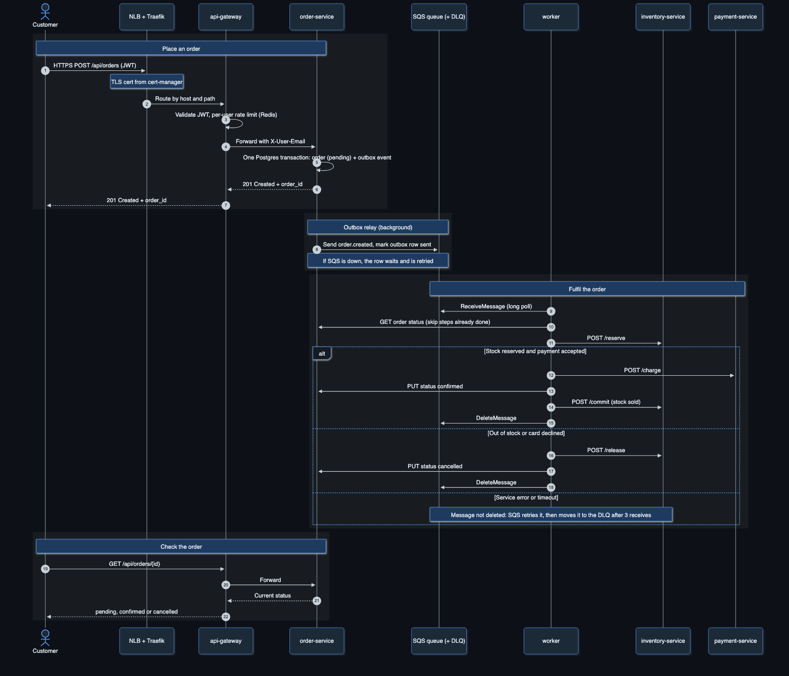
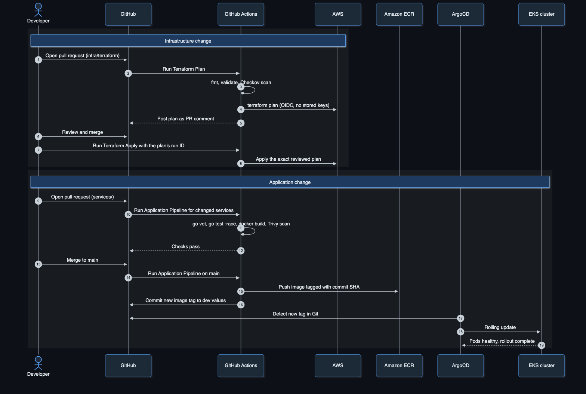

 [README](#e-commerce-order-fulfillment-platform) ·  [Architecture](ARCHITECTURE.md) ·  [Contributing](CONTRIBUTING.md) ·  [Code of conduct](CODE_OF_CONDUCT.md) ·  [MIT license](#license)

# E-commerce Order Fulfillment Platform

[](https://go.dev/) [](https://developer.hashicorp.com/terraform) [](https://aws.amazon.com/eks/) [](https://kubernetes.io/) [](https://www.docker.com/) [](https://helm.sh/) [](https://argo-cd.readthedocs.io/) [](https://karpenter.sh/) [](https://www.postgresql.org/) [](https://aws.amazon.com/sqs/) [](https://github.com/features/actions)

An e-commerce order fulfillment platform made up of nine Go microservices, deployed to Amazon EKS through IaC, CI/CD and ArgoCD GitOps. Each order flows through an SQS-driven worker that reserves stock, charges payment and confirms the order.

---

## Table of Contents

1. [Overview](#overview)
2. [Architecture Diagram](#architecture-diagram)
3. [Request Flow](#request-flow)
4. [Deployment Process](#deployment-process)
5. [Directory Structure](#directory-structure)
6. [Local Setup](#local-setup)

---

## Overview

Customers register, log in and place orders through an API gateway. Each new order is published to an SQS queue, where a worker reserves the stock, charges the payment and confirms the order, or releases the stock and cancels the order if any step fails. Supporting services handle shipping and tracking, customer notifications and scheduled jobs such as expiring stale reservations and retrying failed payments. A dashboard API reports order stats, revenue, shipping and low-stock alerts.

The nine [services](services/) run on an Amazon EKS cluster. Terraform provisions all of the AWS infrastructure with remote state, through GitHub Actions pipelines: a plan on every pull request, then a manual apply of that exact plan. Application changes are delivered through GitOps: the CI pipeline builds, scans and pushes each changed service's image and commits the new image tag to Git, and ArgoCD syncs that change into the cluster, so no pipeline deploys to the cluster directly. Services talk to each other over HTTP and through an SQS event queue, and the dashboard is served over HTTPS, with certificates from cert-manager and DNS records managed by ExternalDNS.

---

## Architecture Diagram


1. **Network**: a VPC across three availability zones in `eu-west-2`. The cluster nodes and the database run in private subnets, and only the load balancer is public.
2. **Edge**: traffic enters through AWS and is routed into the cluster.
   - **DNS**: Route 53 resolves the domain, and ExternalDNS keeps the record pointed at the load balancer.
   - **Load balancing**: an AWS Network Load Balancer passes traffic to Traefik, the ingress controller.
   - **TLS**: cert-manager issues and renews the certificate from Let's Encrypt.
3. **Services**: the nine Go services run in the `order-platform` namespace.
   - **Synchronous**: the API gateway is the single entry point and routes HTTP requests to each service.
   - **Asynchronous**: orders are processed through an Amazon SQS queue, with failed messages moved to a dead-letter queue.
   - **Data**: PostgreSQL stores orders, inventory and payments.
4. **Platform**: shared tools that run alongside the services.
   - **Delivery**: ArgoCD deploys everything from Git.
   - **Scaling**: Karpenter adds and removes nodes based on demand.
   - **Secrets**: External Secrets pulls credentials from AWS Secrets Manager.
   - **Monitoring**: Prometheus and Grafana collect and display metrics.

The reasoning and trade-offs behind these choices are in [ARCHITECTURE.md](ARCHITECTURE.md).

---

## Request Flow



1. **Place an order**: the customer sends `POST /api/orders` with their JWT.
   - **Edge**: the Network Load Balancer passes the request to Traefik, which terminates TLS with the certificate from cert-manager.
   - **Gateway**: the API gateway checks the JWT, rate limits per user in Redis and forwards the request to order-service.
   - **Save**: order-service saves the order as `pending` and its `order.created` event in one PostgreSQL transaction, then returns `201 Created` with the order ID.
2. **Outbox relay**: a background loop in order-service sends saved events to SQS and marks them as sent. If SQS is down, the events wait and are retried, so no order is lost.
3. **Fulfil the order**: the worker picks up the event from SQS and first checks the order's status, so a repeated message never redoes a finished step.
   - **Success**: it reserves the stock, charges the payment, confirms the order, commits the stock and deletes the message.
   - **Out of stock or card declined**: it releases the stock, cancels the order and deletes the message.
   - **Error or timeout**: the message is not deleted, so SQS retries it and moves it to the dead-letter queue after three attempts.
4. **Check the order**: the customer calls `GET /api/orders/{id}` through the gateway to see whether the order is pending, confirmed or cancelled.

---

## Deployment Process



1. **Containerise**: each service has a multi-stage Dockerfile. Go builds a static binary in the first stage, which is copied into a minimal distroless image that runs as a non-root user.
2. **Pull request checks**: each pull request runs only the pipelines for the code it changes.
   - **Services**: `go vet`, `go test -race`, `docker build` and a Trivy image scan that fails on HIGH or CRITICAL vulnerabilities.
   - **Helm**: `helm lint`, then every service is rendered and the manifests are validated against Kubernetes schemas with kubeconform.
   - **Terraform**: `fmt`, `validate`, a Checkov security scan and a `terraform plan` posted as a comment on the pull request.
3. **Provision infrastructure**: Terraform Apply is started manually and applies the exact plan reviewed on the pull request. Pipelines sign in to AWS through GitHub OIDC, so no AWS keys are stored.
4. **Release images**: on merge to `main`, each changed service's image is pushed to ECR, tagged with the commit SHA. The pipeline then commits the new tag to the dev values file in Git.
5. **Deploy with GitOps**: ArgoCD sees the new tag in Git and rolls it out with a rolling update. No pipeline deploys to the cluster directly, and a rollback is a revert of the tag commit.
6. **Tear down**: Terraform Destroy needs a manual approval before it runs.

---

## Directory Structure

```
Alpha-Pilot-4week/
│
├── .github/
│   └── workflows/
│
├── bootstrap/
│
├── images/
│
├── infra/
│   ├── terraform/
│   ├── argocd-bootstrap/
│   └── kind/
│
├── kubernetes/
│   ├── charts/
│   ├── deploy/
│   ├── helm-values/
│   └── platform/
│
├── scripts/
│
├── services/
│
├── docker-compose.yml
└── Makefile
```

---

## Local Setup

### Prerequisites

- AWS CLI v2, signed in to the AWS account
- Terraform >= 1.16
- kubectl
- Helm
- Docker

### 1. Bootstrap Remote State, ECR & DNS

Before provisioning infrastructure, run the bootstrap. It creates the S3 bucket for remote state, the ECR repository, the GitHub Actions OIDC role and the Route 53 hosted zone.

```bash
terraform -chdir=bootstrap init
terraform -chdir=bootstrap apply
```

Then delegate the subdomain by adding the hosted zone's four name servers as `NS` records in Cloudflare (see [kubernetes/README.md](kubernetes/README.md#dns-one-off)).

### 2. Add the ArgoCD Deploy Key

Create a read-only GitHub deploy key so ArgoCD can read this private repository. Store the private key in Secrets Manager, and add the public key under the repo's **Settings → Deploy keys**.

```bash
aws secretsmanager create-secret --name eks-v2-dev-argocd-deploy-key --secret-string file://<path-to-private-key>
```

### 3. Provision Infrastructure

In GitHub Actions, run **Terraform Plan**, then **Terraform Apply** with the plan's run ID.

### 4. Bootstrap ArgoCD

Run **ArgoCD Bootstrap** with the run ID left empty to plan, then again with that plan's run ID to apply. ArgoCD then installs the platform tools and all nine services, and the pipeline waits until every application is healthy.

### 5. Configure kubectl

Your IAM role needs an EKS access entry on the cluster.

```bash
aws eks update-kubeconfig --region eu-west-2 --name eks-v2-dev-cluster
kubectl -n argocd get applications
```

### 6. Run the App Locally

```bash
docker compose up --build
# API gateway: http://localhost:8080
# Dashboard:   http://localhost:8086
```

`make help` lists shortcuts for starting, stopping, testing and linting the services.

---

## License

This project is licensed under the MIT License. You are free to use, copy, modify and distribute it, provided the copyright notice and permission notice are included. The software is provided "as is", without warranty of any kind.
